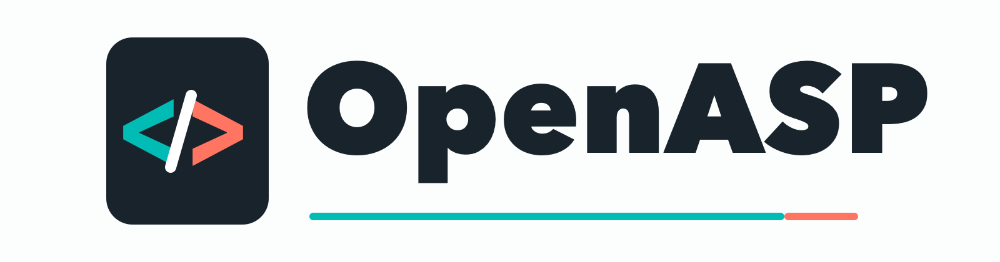

# OpenASP: Classic ASP for Linux Unix and MacOS

<p align="center" id="openasp-top">
  
</p>

<p align="center">
  <a href="#build-from-source"></a>
  <a href="https://spdx.org/licenses/MIT.html"></a>
  <a href="#why-openasp"></a>
</p>

<p align="center">
  <a href="#install-a-binary-package">Install</a> |
  <a href="#build-from-source">Build</a> |
  <a href="#hello-world">Hello World</a> |
  <a href="#command-line-tools">CLI Tools</a> |
  <a href="#deploy-with-nginx">Nginx</a> |
  <a href="#compatibility-and-components">Compatibility</a> |
  <a href="https://asp-lang.org">Website</a> |
  <a href="README.zh-CN.md">简体中文</a>
</p>

The official OpenASP website is **[https://asp-lang.org](https://asp-lang.org)**. Questions, suggestions, and ideas are always welcome. Please send feedback through the official website.

OpenASP is a Classic ASP interpreter and resident runtime implemented in pure C11. It runs existing VBScript/ASP applications natively on Linux, Unix and MacOS without Windows Server or IIS. It provides standalone page rendering, a persistent interactive environment, a multi-process FastCGI service, ADO-compatible data access, native components, bytecode caching, and debugging tools.

## Why OpenASP

OpenASP is more than a compatibility layer. It preserves familiar Classic ASP and VBScript behavior while replacing the Windows-specific hosting stack with a portable runtime designed for current production environments. Existing applications can move to Linux, Unix, or MacOS without rewriting business code around a different language or web framework.

The runtime also extends Classic ASP with modern native capabilities. ASP code can use MySQL/MariaDB, SQLite, MDB, Redis, Memcache, HTTP/WebSocket clients, JSON, cryptography, and OpenAI-compatible APIs directly through `Server.CreateObject`, without a separate bridge service.

| Traditional Classic ASP | OpenASP |
| --- | --- |
| Requires Windows Server | Runs natively on Linux, Unix and MacOS |
| Hosted by IIS | Runs standalone or behind Nginx/FastCGI |
| Depends on Windows COM components | Provides portable native C components |
| Migration work leaks into ASP code | Compatibility work stays inside the engine |
| Access to modern services | Extends ASP with native Redis, MySQL/MariaDB, and OpenAI integrations |

## Install a Binary Package

OpenASP release archives use the following names:

| Platform | Archive |
| --- | --- |
| Linux x86-64 | [`openasp-0.1.0-linux-x86-64.tar.gz`](https://github.com/asp-lang/openasp/releases/download/v-0.1.0/openasp-0.1.0-linux-x86-64.tar.gz) |
| MacOS Apple Silicon | [`openasp-0.1.0-macos-arm64.zip`](https://github.com/asp-lang/openasp/releases/download/v-0.1.0/openasp-0.1.0-macos-arm64.zip) |

Download the matching archive from the project release page or [https://asp-lang.org](https://asp-lang.org), then extract it:

```sh
# Linux x86-64
tar -xzf openasp-0.1.0-linux-x86-64.tar.gz

# MacOS Apple Silicon
unzip openasp-0.1.0-macos-arm64.zip
```

Each package contains the five programs under `bin/`, the public extension headers under `include/`, and an example FPM configuration. Add `bin/` to `PATH` and verify the installation:

```sh
export PATH="/path/to/openasp-0.1.0-linux-x86-64/bin:$PATH"
openasp --help
```

Use the extracted MacOS directory name when installing on Apple Silicon.

## Build from Source

OpenASP requires a C11 compiler, `make`, `pkg-config`, PCRE2, libxml2, libcurl, SQLite, json-c, OpenSSL, a MySQL/MariaDB client library, and mdbtools.

### Ubuntu 24.04

```sh
sudo apt-get update
sudo apt-get install -y \
    build-essential pkg-config \
    libpcre2-dev libxml2-dev libcurl4-openssl-dev libsqlite3-dev \
    libjson-c-dev libssl-dev libmariadb-dev mdbtools-dev \
    libglib2.0-dev gettext
```

### MacOS

Install the Xcode command-line tools and Homebrew dependencies:

```sh
xcode-select --install
brew install pkg-config pcre2 libxml2 curl sqlite json-c openssl@3 \
    mariadb-connector-c mdbtools
```

### Compile and Test

From the repository root:

```sh
make clean
make all
make test
```

The five executables are written to `build/bin/`. The full profile includes all native components. A smaller profile keeps the core runtime, persistent state, SQLite, json-c, and `Scripting.Dictionary`:

```sh
make minimal
make minimal-test
```

Additional verification targets:

```sh
make test-all
make external-test
make fixture-diff
make asan
```

Release archives can be built with:

```sh
scripts/make-release.sh macos
scripts/make-release.sh linux
scripts/make-release.sh all
```

Archives are written to `release/`. Linux x86-64 releases can be built from Apple Silicon through the local `ubuntu:24.04` Docker image and QEMU.

## Hello World

Create a site directory and save the following page as `/tmp/openasp-site/HelloWorld.asp`:

```asp
<%@ Language=VBScript %>
<%
Response.ContentType = "text/html; charset=utf-8"

Dim name
name = Request.QueryString("name")
If name = "" Then name = Request.Form("name")
If name = "" Then name = "World"
%>
<!doctype html>
<html>
<head>
  <meta charset="utf-8">
  <title>OpenASP Hello World</title>
</head>
<body>
  <h1>Hello, <%= Server.HTMLEncode(name) %>!</h1>
</body>
</html>
```

Render it directly without a web server:

```sh
mkdir -p /tmp/openasp-site
openasp /tmp/openasp-site/HelloWorld.asp \
    --root /tmp/openasp-site \
    --query "name=OpenASP"
```

When running a source build, replace `openasp` with
`./build/bin/openasp`. The output contains:

```html
<h1>Hello, OpenASP!</h1>
```

The standalone runner can also simulate a form request:

```sh
openasp /tmp/openasp-site/HelloWorld.asp \
    --root /tmp/openasp-site \
    --method POST \
    --body "name=OpenASP"
```

## Command-line Tools

| Program | Purpose |
| --- | --- |
| `openasp` | Render ASP pages, simulate requests, and export OAC bytecode |
| `openasp-fpm` | Serve ASP through FastCGI using synchronous worker processes |
| `openasp-cli` | Run a persistent interactive VBScript/OpenASP session |
| `openasp-dis` | Validate and disassemble `.oac` bytecode images |
| `openasp-dbg` | Debug ASP source or OAC images at source and opcode level |

### `openasp`

```sh
openasp page.asp --root /srv/www/site --query "id=42"
openasp page.asp --root /srv/www/site \
    --emit-oac /tmp/page.oac --gen-dbg-info=on
openasp service.asp --root /srv/www/site \
    --runtime-mode=service --gc-heap-limit=256M --gc-diagnostics
```

The default `service` runtime uses the non-moving generational GC. Explicit `--runtime-mode=batch` uses a request arena. High-risk process capabilities remain disabled unless `--process-enable=on` or `--shell-enable=on` is passed.

### `openasp-cli`

```sh
openasp-cli --root /srv/www/site
```

Variables, functions, classes, `Session`, and `Application` remain available between inputs. Enter `? expression` to print a value, `:help` for commands, and `:quit` to exit. Arrow keys, Home/End, Backspace, and Delete are supported in an interactive terminal.

At the top-level prompt, input beginning with `!` executes the remaining text through `$SHELL` and streams its standard output and error directly to the terminal:

```text
OpenASP> !pwd
/srv/www/site
```

Shell commands are enabled by default in `openasp-cli` and can be disabled with `--shell-enable=off`; this does not change the shell policy of other OpenASP commands. Only the child command's standard output and error are displayed, including any colors it produces. Interactive terminals display the `OpenASP>` prompt in cyan. Redirected output, `TERM=dumb`, or `NO_COLOR=1` disables prompt formatting.

### `openasp-dis`

Generate an OAC image and inspect its metadata, source mapping, symbols, and 24-byte VM instructions:

```sh
openasp page.asp --root /srv/www/site \
    --emit-oac /tmp/page.oac --gen-dbg-info=on
openasp-dis /tmp/page.oac
```

See [`tools/openasp-dis/README.md`](tools/openasp-dis/README.md) for the output format and validation rules.

### `openasp-dbg`

Debug an ASP source file:

```sh
openasp-dbg page.asp --root /srv/www/site
```

Common commands include `break`, `run`, `continue`, `step`, `next`, `finish`, `backtrace`, `print`, `watch`, `list`, and `disassemble`. The debugger can also open OAC files created with `--gen-dbg-info=on`.

See [`tools/openasp-dbg/README.md`](tools/openasp-dbg/README.md) for local and remote FPM debugging.

### `openasp-fpm`

Start a development FastCGI service on loopback:

```sh
openasp-fpm \
    --root /srv/www/example \
    --host 127.0.0.1 \
    --port 9000 \
    --workers 4 \
    --max-requests 10000 \
    --opcache-memory 64 \
    --log-file stderr \
    --log-level info
```

Each worker handles one FastCGI connection at a time. Set the required concurrency directly with `--workers`; the maximum is 256. Configuration can also be loaded from YAML:

```sh
openasp-fpm -c /etc/openasp-fpm.yaml
```

Command-line values override YAML, which overrides built-in defaults. A complete example is available at [`examples/openasp-fpm.yaml`](examples/openasp-fpm.yaml).

## Deploy with Nginx

### 1. Start OpenASP FastCGI

For a first deployment, bind FastCGI to loopback:
Create `/var/cache/openasp` first and grant the FPM service account write access to it.

```sh
openasp-fpm \
    --root /srv/www/example \
    --host 127.0.0.1 \
    --port 9000 \
    --workers 4 \
    --opcache-memory 64 \
    --opcache-dir /var/cache/openasp \
    --opcache-validate-timestamps=off \
    --log-file stderr
```

The FPM `--root` and the Nginx `root` must identify the same physical directory.

### 2. Configure Nginx

Create `/etc/nginx/conf.d/openasp.conf`:

```nginx
server {
    listen 8080;
    server_name _;

    root /srv/www/example;
    index default.asp;
    client_max_body_size 32m;

    location / {
        try_files $uri $uri/ /default.asp?$query_string;
    }

    location ~ \.asp$ {
        try_files $uri =404;
        include /etc/nginx/fastcgi_params;

        fastcgi_param SCRIPT_FILENAME $document_root$fastcgi_script_name;
        fastcgi_param SCRIPT_NAME     $fastcgi_script_name;
        fastcgi_param DOCUMENT_ROOT   $document_root;
        fastcgi_param PATH_INFO       "";
        fastcgi_param PATH_TRANSLATED $document_root$fastcgi_script_name;

        fastcgi_pass 127.0.0.1:9000;
        fastcgi_read_timeout 120s;
    }

    location ~* \.(asa|inc)$ {
        deny all;
    }
}
```

On Homebrew Nginx, `fastcgi_params` is normally located at `/opt/homebrew/etc/nginx/fastcgi_params`.

Validate the configuration, reload Nginx, and request the Hello World page:

```sh
sudo nginx -t
sudo nginx -s reload
curl 'http://127.0.0.1:8080/HelloWorld.asp?name=OpenASP'
```

For a Unix socket, start FPM with
`--unix-socket /run/openasp/openasp-fpm.sock`, replace `fastcgi_pass` with `unix:/run/openasp/openasp-fpm.sock`, and ensure the Nginx and OpenASP service accounts share access to the socket directory. OpenASP creates the socket with mode `0660`.

### Production Checklist

- Run Nginx and `openasp-fpm` as unprivileged service accounts.
- Keep TCP FastCGI bound to loopback, or use a protected Unix socket.
- Keep `shell-enable` and `process-enable` off unless a trusted application requires them.
- Make the site read-only except for explicit upload, state, cache, and log directories.
- Use systemd, launchd, or another service manager to supervise `openasp-fpm`.
- Keep timestamp validation on during development; disable it in production only when deployments restart workers.
- Set request, body, response, header, timeout, and memory limits for the application.

## Compatibility and Components

OpenASP implements the Classic ASP object model directly:

| Area | Supported surface |
| --- | --- |
| VBScript | Procedures, classes, arrays, `ByRef`, errors, `On Error Resume Next`, built-ins |
| ASP objects | `Request`, `Response`, `Server`, `Session`, `Application`, `Err` |
| Request data | Query strings, forms, cookies, server variables, headers, `BinaryRead` |
| Response | Buffering, headers, cookies, status, redirects, text and binary output |
| Includes | Classic file and virtual includes |
| Data access | SQLite, MySQL/MariaDB, Jet 4/MDB, Recordset, Command, parameters |

Portable native components include:

- `Scripting.Dictionary`, `Scripting.FileSystemObject`, and `VBScript.RegExp`
- `ADODB.Connection`, `ADODB.Recordset`, `ADODB.Command`, and `ADODB.Stream`
- XML DOM, XMLHTTP, HTTP, JSON, and Crypto
- Socket, WebSocket/WSS, Redis, and Memcache
- OpenAI-compatible APIs
- `OpenASP.Process` and `Shell.Application`, disabled by default

External native extensions can be loaded through the stable C ABI. 

## Architecture and Documentation

ASP templates and includes are parsed and compiled into validated bytecode. Standalone and service runtimes execute that bytecode directly; FPM stores immutable compiled modules in a shared cross-process cache with an optional disk OAC cache. Request memory uses mmap-backed arenas, while persistent CLI service mode uses a non-moving generational GC.

| Path | Responsibility |
| --- | --- |
| `src/compiler/` | ASP preprocessing, lexer, parser, symbols, and bytecode |
| `src/runtime/` | Values, execution, VM dispatch, and debugging hooks |
| `src/engine/` | Engine lifecycle and standalone/service rendering |
| `src/web/` | FastCGI protocol, workers, requests, and limits |
| `src/components/` | Built-in and external component implementations |
| `src/storage/` | Shared bytecode cache and persistent state |
| `tools/` | Disassembler and debugger |
| `tests/` | Unit, integration, conformance, e2e, stress, and benchmarks |

## Security

`OpenASP.Process` and `Shell.Application` are disabled by default. Do not enable them for untrusted sites. External extensions are administrator allow-listed, and FastCGI applies request, body, response, header, timeout, and memory limits. API keys and database credentials should be supplied by the deployment environment, not committed to ASP source.

## Version

The current source version is `0.1.0`, defined by `OPENASP_VERSION` in `src/cmd/version.h`.

## More to Try

[uYasoo-MicroBlog](https://github.com/asp-lang/uyasoo-microblog) is a complete Classic ASP microblog built for OpenASP. It uses Redis for application data and runs behind Nginx through `openasp-fpm`, with support for user profiles, follows, timelines, topics, posts, comments, likes, search, image uploads, and more. Follow the project documentation to run it with OpenASP.
